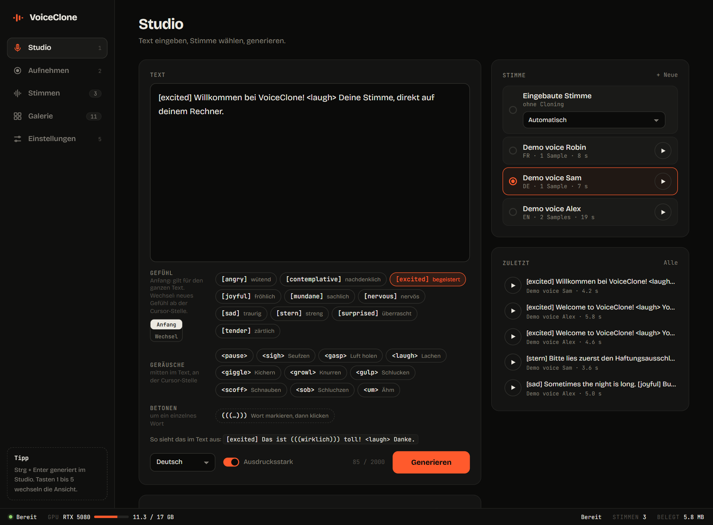
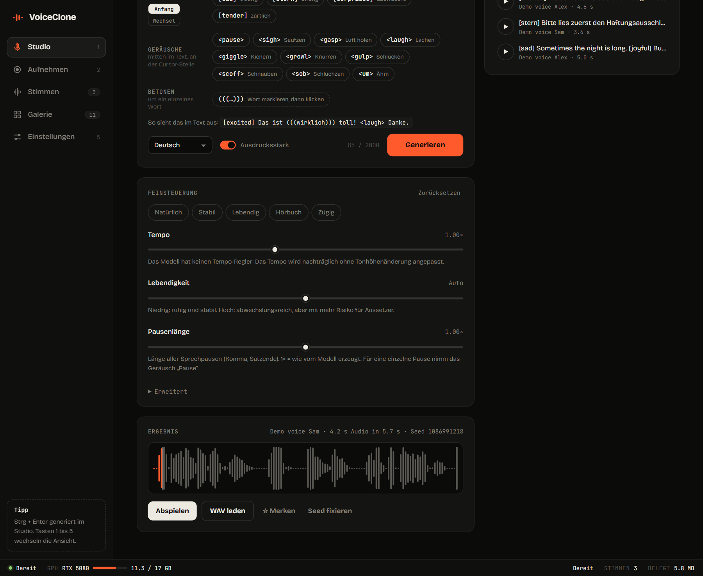
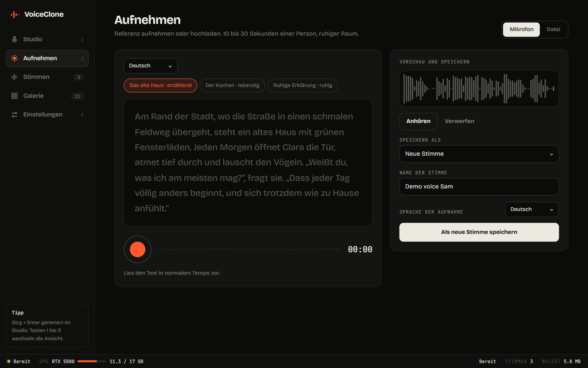
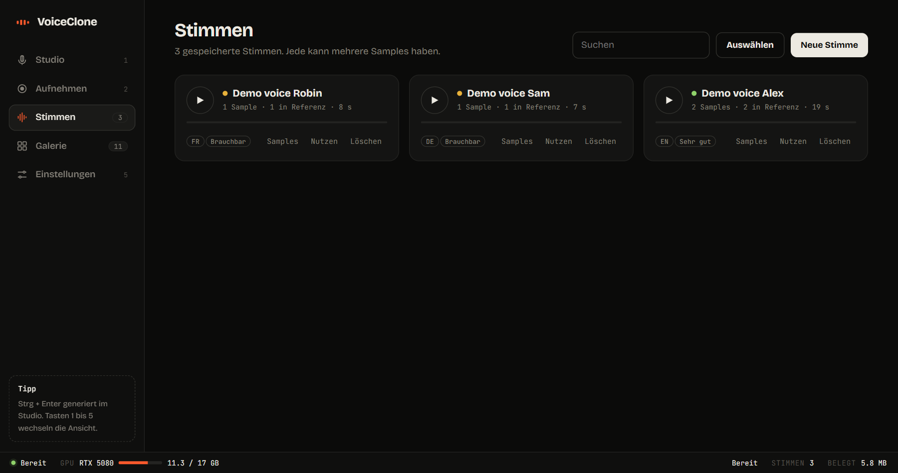
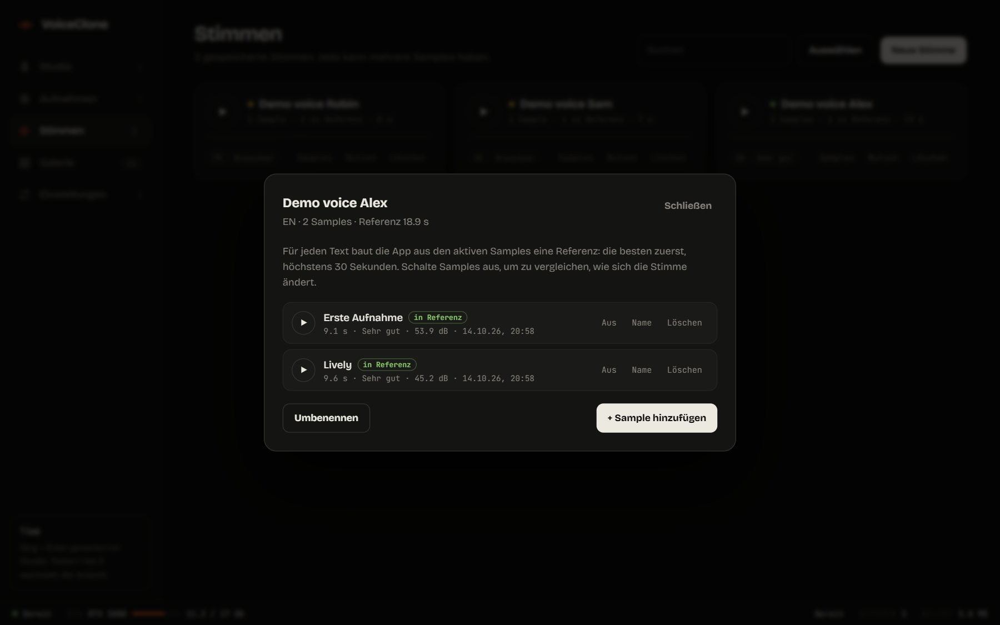
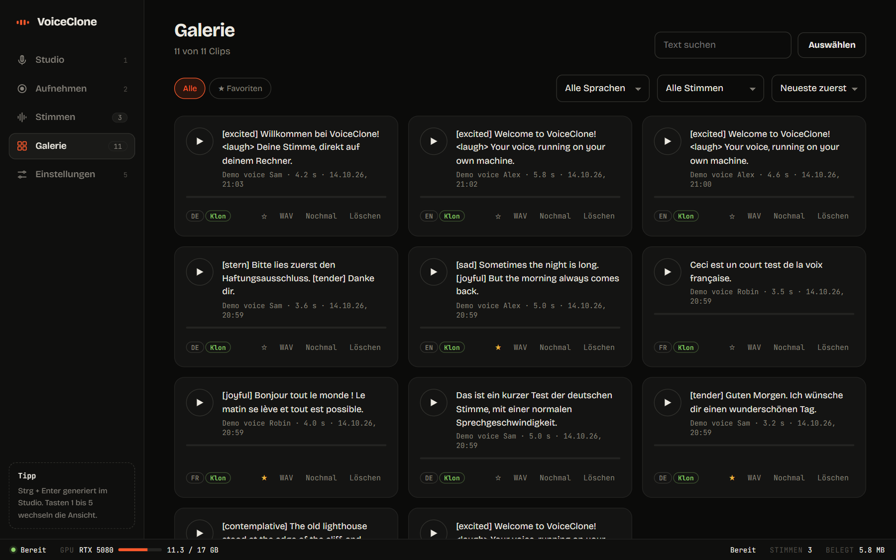
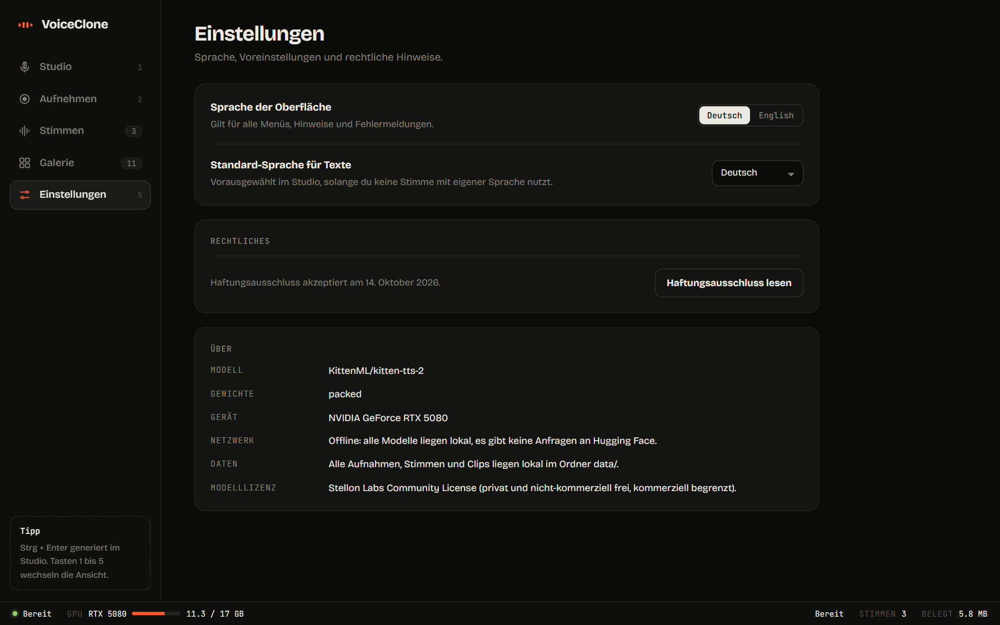
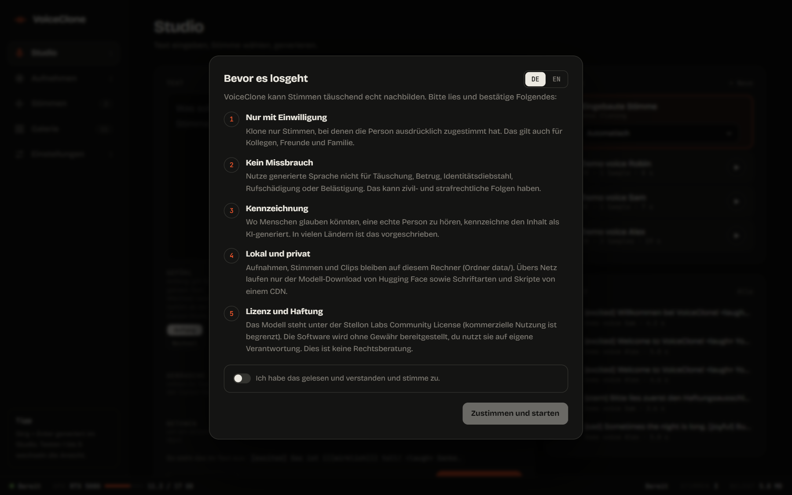

# VoiceClone

[](LICENSE)

-lightgrey)


Eine lokale Web-App, die mit [KittenTTS 2](https://huggingface.co/KittenML/kitten-tts-2) Stimmen klont und beliebige Texte damit spricht. Nimm dich im Browser auf (oder lade eine Datei hoch), speichere die Stimme und erzeuge Sprache in 10 Sprachen, mit Kontrolle über Gefühl, Geräusche, Betonung, Tempo und Pausen. Alles läuft auf deinem eigenen Rechner.

**Repository:** <https://github.com/N0tMaggi/VoiceClone> · [Deployment](DEPLOY.md) · [Architektur](docs/ARCHITECTURE.md) · [Haftungsausschluss](DISCLAIMER.md) · [Drittanbieter-Lizenzen](THIRD_PARTY.md) · [Lizenz](LICENSE) · [English](README.md)



> **Verantwortungsvoll nutzen.** Stimmklonen kann missbraucht werden. Klone nur Stimmen von Personen, die ausdrücklich zugestimmt haben, und lies [DISCLAIMER.md](DISCLAIMER.md), bevor du die App benutzt. Beim ersten Start zeigt die App denselben Hinweis.

## Inhalt

[Funktionen](#funktionen) · [Screenshots](#screenshots) · [Schnellstart](#schnellstart) · [Wie das Klonen funktioniert](#wie-das-klonen-hier-funktioniert) · [Was das Modell kann](#was-das-modell-kann-und-was-nicht) · [Offline-Modus](#offline-modus) · [Konfiguration](#konfiguration) · [Datenschutz](#deine-daten-bleiben-privat) · [Projektstruktur](#projektstruktur) · [Tests](#tests) · [Lizenz](#lizenz)

## Funktionen

- **Aufnehmen oder hochladen:** Mikrofonaufnahme mit Pegelanzeige und Teleprompter (Vorlesetexte in 10 Sprachen) oder Dateien (WAV, MP3, FLAC, OGG).
- **Qualitätscheck** für jede Aufnahme: Länge, Übersteuerung, Pegel, Rauschen. Du bekommst Hinweise, bevor du speicherst.
- **Stimmen-Bibliothek:** Eine Stimme ist eine Sammlung von Samples. Du kannst später weitere hinzufügen, ein- und ausschalten, umbenennen oder löschen. Die App baut aus den aktiven Samples die beste Referenz (bis 30 s).
- **Studio:** Text rein, Sprache raus, in 10 Sprachen (Englisch, Deutsch, Französisch, Spanisch, Italienisch, Portugiesisch, Russisch, Chinesisch, Arabisch, Hindi). Eingebaute Stimmen gibt es auch.
- **Ausdruck:** 10 Gefühle, 10 Geräusche (Lachen, Seufzen, ...), Wortbetonung und **Gefühlswechsel im Text** (jeder Abschnitt wird einzeln erzeugt).
- **Feinsteuerung:** Tempo, Pausenlänge, Lebendigkeit (Temperatur), Streuung (top_p), Referenz im Prompt und ein **Seed**, um einen Take exakt zu wiederholen.
- **Galerie** aller erzeugten Clips: Suche, Filter, Favoriten, Mehrfach-Löschen.
- **Statusleiste** mit Modellstatus, GPU-Speicher und Speicherbelegung. Oberfläche auf Deutsch und Englisch.
- **Offline-Modus:** Nach dem ersten Download macht die App keine Anfragen mehr an Hugging Face.

## Screenshots

Die Screenshots zeigen Demo-Stimmen, die aus den eingebauten KittenTTS-Stimmen erzeugt wurden. Es ist keine Aufnahme einer realen Person zu sehen.

<table>
  <tr>
    <td width="50%"><br><sub><b>Feinsteuerung und Ergebnis.</b> Tempo, Lebendigkeit, Pausenlänge, Voreinstellungen und ein Seed, den du fixieren kannst, um einen Take zu wiederholen.</sub></td>
    <td width="50%"><br><sub><b>Aufnehmen.</b> Teleprompter mit Vorlesetexten in 10 Sprachen, Pegelanzeige sowie Vorschau und Speichern.</sub></td>
  </tr>
  <tr>
    <td width="50%"><br><sub><b>Stimmen.</b> Jede Stimme mit Sprache, Anzahl der Samples und Qualitätsbewertung.</sub></td>
    <td width="50%"><br><sub><b>Samples.</b> Schalte Samples ein und aus, um zu vergleichen, wie sich die Stimme ändert; die App baut die beste Referenz.</sub></td>
  </tr>
  <tr>
    <td width="50%"><br><sub><b>Galerie.</b> Alle Clips mit Suche, Sprach- und Stimmenfiltern, Favoriten und Mehrfach-Löschen.</sub></td>
    <td width="50%"><br><sub><b>Einstellungen.</b> Sprache der Oberfläche, Standard-Sprache, Haftungsausschluss und was wo läuft (auch der Offline-Modus).</sub></td>
  </tr>
  <tr>
    <td colspan="2"><br><sub><b>Erster Start.</b> Die App lässt dich zuerst die Nutzungsregeln bestätigen.</sub></td>
  </tr>
</table>

## Schnellstart

Voraussetzungen: [uv](https://docs.astral.sh/uv/), Python 3.11 bis 3.13 (uv kann es installieren) und idealerweise eine NVIDIA-GPU. Getestet auf Windows 11 mit einer RTX 5080 (16 GB). Details und andere Plattformen stehen in [DEPLOY.md](DEPLOY.md).

```bash
git clone https://github.com/N0tMaggi/VoiceClone.git
cd VoiceClone
uv sync
uv run python run.py
```

Der erste Start lädt etwa 5 GB Modelle (KittenTTS 2, Whisper large-v3 und einen Decoder) von Hugging Face. Danach startet die App offline in etwa 40 Sekunden (Modell laden plus Aufwärmen) und öffnet `http://127.0.0.1:8765`.

Optionaler Machbarkeitstest (GPU, Cloning, Deutsch) vor dem Start der App:

```bash
uv run python scripts/spike.py pfad/zu/deiner_aufnahme.wav
```

## Wie das Klonen hier funktioniert

KittenTTS 2 trainiert nicht auf deine Stimme. Bei jeder Anfrage bekommt es eine **Referenzaufnahme von 5 bis 30 Sekunden** einer Person und ahmt sie nach (In-Context-Cloning). Whisper transkribiert die Referenz automatisch. Mehr Samples lassen die Stimme also nicht mehr "lernen"; sie geben der App besseres Material für die Referenz, und du kannst verschiedene Stile (ruhig, lebendig, anderes Mikrofon) nebeneinander behalten.

## Was das Modell kann und was nicht

| Steuerung | Woher |
|---|---|
| 10 Gefühle (`[excited]`), 10 Geräusche (`<laugh>`), Betonung (`(((wort)))`) | das Modell |
| Preset `stable` / `expressive`, Temperatur, top_p, top_k, Seed, Referenz im Prompt | das Modell |
| Tempo | **die App**, nach der Erzeugung (Phase-Vocoder, Tonhöhe bleibt) |
| Pausenlänge | **die App**, nach der Erzeugung (stille Stellen werden skaliert) |
| Gefühlswechsel im Text | **die App:** Der Text wird an jedem `[Gefühl]` aufgeteilt, jeder Abschnitt einzeln erzeugt |

Das Modell hat keinen Tempo-Regler und nur eine Pausensteuerung, die bei sehr langen Texten greift. Extreme Tempowerte (unter 0,8× oder über 1,25×) können künstlich klingen. Die Gefühls-Tags sind von den Modellautoren als Beta gekennzeichnet und wirken je nach Stimme und Satz unterschiedlich stark. Die Qualität unterscheidet sich je Sprache; Deutsch funktioniert in unseren Tests gut, die anderen bitte selbst prüfen.

## Offline-Modus

Sind alle drei Modelle vollständig heruntergeladen, setzt die App `HF_HUB_OFFLINE=1` selbst: keine Update-Prüfung, keine Token-Warnung, schnellerer Start. Die Einstellungen zeigen den aktuellen Netzwerkmodus. Zum Aktualisieren der Modelle einmal mit `VOICECLONE_OFFLINE=0` starten.

## Konfiguration

| Variable | Werte | Wirkung |
|---|---|---|
| `VOICECLONE_HOST` | Standard `127.0.0.1` | Bind-Adresse (die App hat **keine Authentifizierung**, bleib bei localhost) |
| `VOICECLONE_PORT` | Standard `8765` | Port |
| `VOICECLONE_NO_BROWSER` | `1` | Browser beim Start nicht öffnen |
| `VOICECLONE_WEIGHTS` | `packed` (Standard), `emb4`, `full` | Gewichtsvariante |
| `VOICECLONE_DECODER` | `default`, `student_w4` | kleinerer Decoder |
| `VOICECLONE_OFFLINE` | `auto` (Standard), `1`, `0` | Offline-Modus: automatisch, immer, nie |

## Deine Daten bleiben privat

Stimmen, Samples, erzeugtes Audio und Einstellungen liegen in `data/` neben der App. Die `.gitignore` schließt `data/`, `samples/`, `spike_out/` und **jeden Audiodateityp** bewusst aus, damit Aufnahmen und erzeugte Sprache nie versehentlich committet werden. Ein Pre-Commit-Hook und ein Test prüfen das zusätzlich (siehe `scripts/check_private_files.py`). Git übernimmt Hook-Einstellungen nicht in einen frischen Klon, also aktiviere den Wächter einmal pro Klon:

```bash
git config core.hooksPath scripts/hooks
```

Der Wächter stoppt sogar `git add -f`. Nichts wird hochgeladen; Netzwerkverkehr gibt es nur für den Modell-Download von Hugging Face sowie für Schriftarten und Skripte von CDNs (wie du die selbst hostest, steht in [DEPLOY.md](DEPLOY.md)).

## Projektstruktur

```
app/        FastAPI-Backend: Engine (Modell-Wrapper), Audio, Stimmen, Gefühle, Einstellungen, Offline-Modus
static/     die Web-Oberfläche (reines HTML/CSS/JS, kein Build-Schritt) mit i18n.js für DE/EN-Texte
scripts/    spike.py (Machbarkeitstest), check_private_files.py (Commit-Wächter), hooks/
tests/      pytest-Suite (läuft ohne das Modell)
docs/       ARCHITECTURE.md und die Screenshots in docs/images/
data/       entsteht zur Laufzeit, von Git ignoriert
```

## Tests

```bash
uv run pytest
```

Die Tests brauchen weder das Modell noch eine GPU.

## Lizenz

Der Code dieses Repositorys steht unter der [MIT-Lizenz](LICENSE).

Die verwendeten Modelle und Bibliotheken haben eigene Lizenzen, aufgelistet in [THIRD_PARTY.md](THIRD_PARTY.md). Am wichtigsten: Die **KittenTTS-2-Gewichte stehen unter der Stellon Labs Community License**, die Forschung, nicht-kommerzielle und begrenzte kommerzielle Nutzung erlaubt (siehe [Modellkarte](https://huggingface.co/KittenML/kitten-tts-2)). Whisper (Apache-2.0) und das Decoder-Modell (MIT) haben eigene Bedingungen auf ihren Modellkarten. Die MIT-Lizenz dieses Repositorys ändert nichts an der Modelllizenz; prüfe alle, bevor du etwas kommerziell nutzt oder weitergibst.

Dieses Projekt steht in keiner Verbindung zu KittenML, Stellon Labs, Resemble AI, OpenAI oder Hugging Face.
