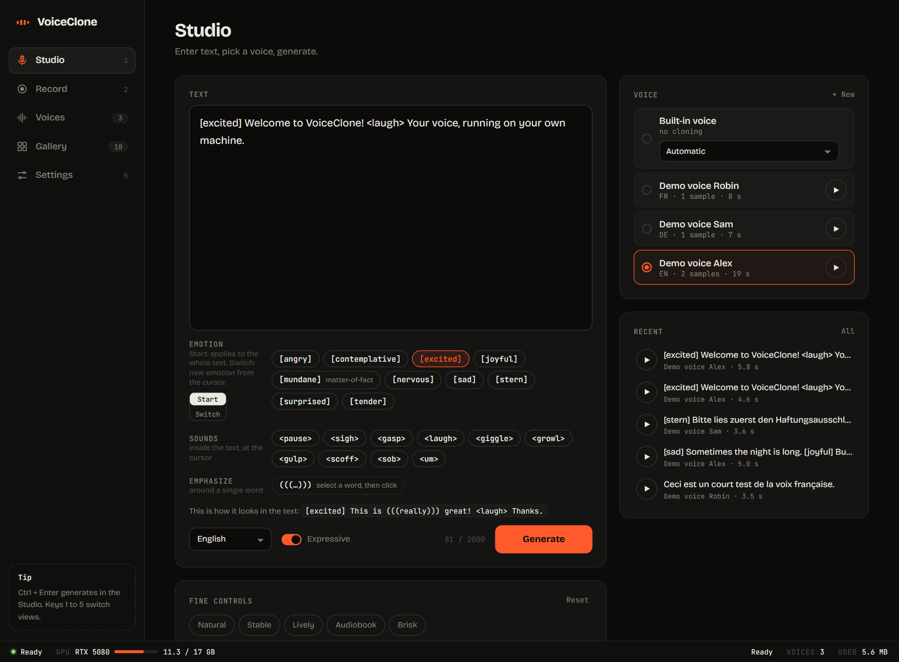
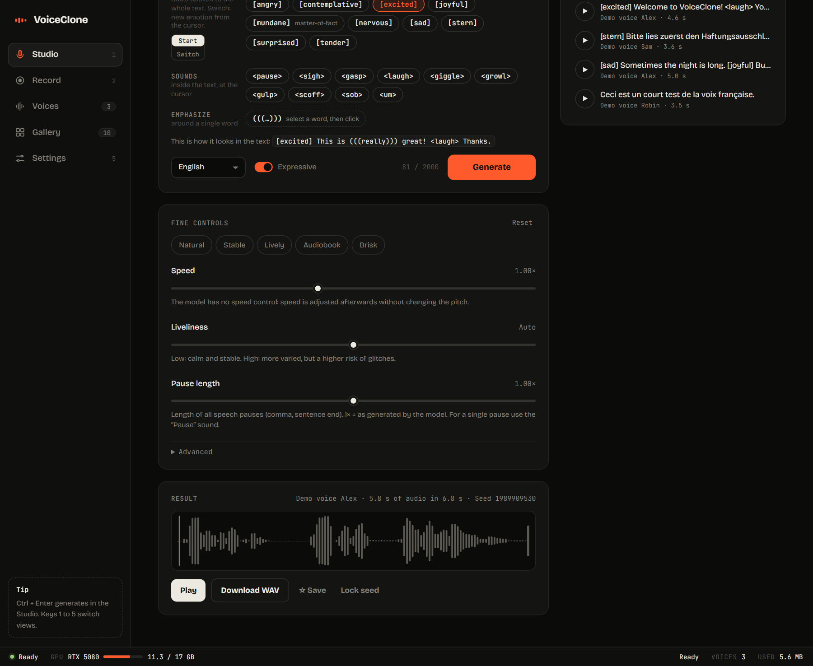
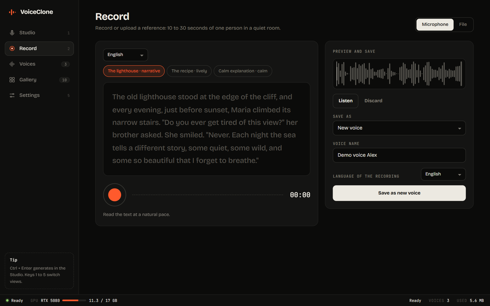
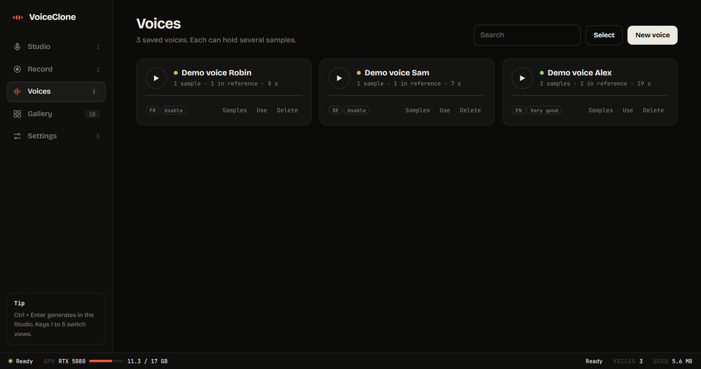
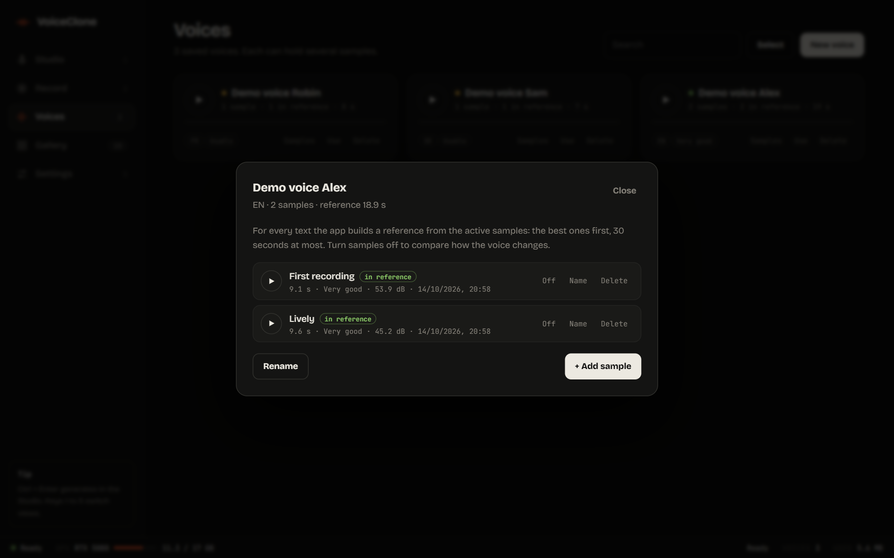
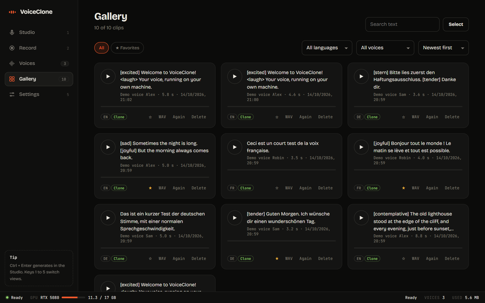
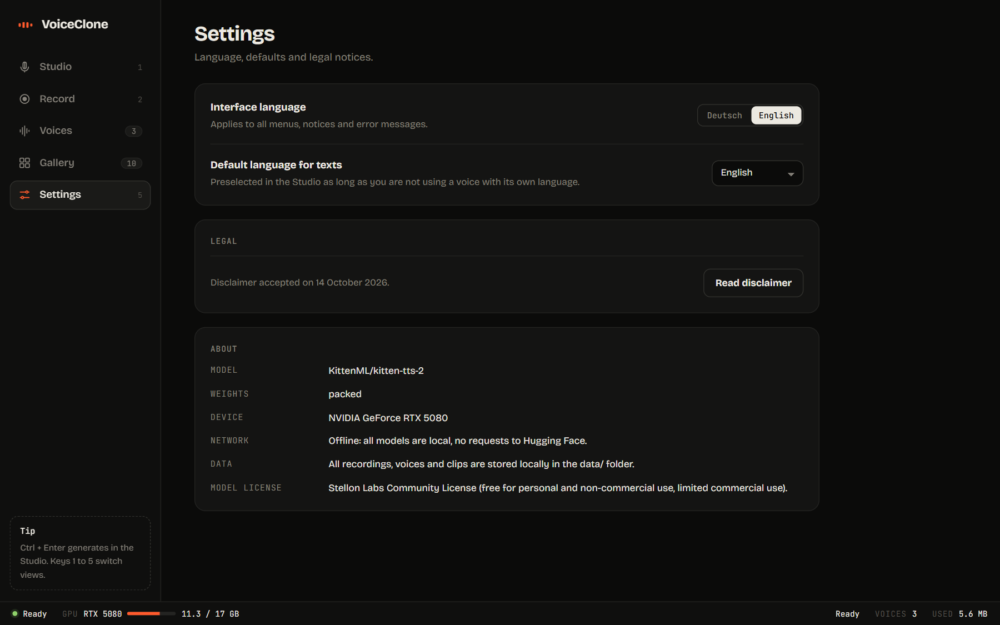
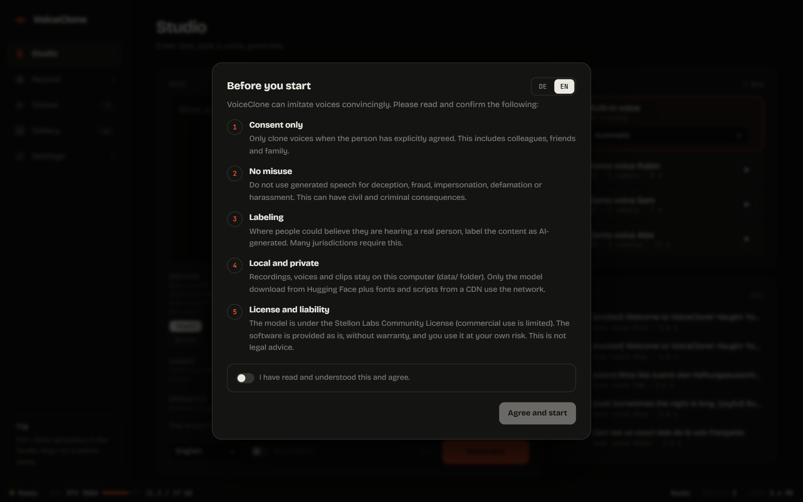

# VoiceClone

[](LICENSE)

-lightgrey)


A local web app for cloning a voice with [KittenTTS 2](https://huggingface.co/KittenML/kitten-tts-2) and speaking any text with it. Record yourself in the browser (or upload a file), save the voice, then generate speech in 10 languages with control over emotion, sounds, emphasis, speed and pauses. Everything runs on your own machine.

**Repository:** <https://github.com/N0tMaggi/VoiceClone> · [Deploy](DEPLOY.md) · [Architecture](docs/ARCHITECTURE.md) · [Disclaimer](DISCLAIMER.md) · [Third-party licenses](THIRD_PARTY.md) · [License](LICENSE) · [Deutsch](README.de.md)



> **Responsible use.** Voice cloning can be misused. Only clone voices of people who explicitly agreed, and read [DISCLAIMER.md](DISCLAIMER.md) before using the app. The app shows the same notice on first start.

## Contents

[Features](#features) · [Screenshots](#screenshots) · [Quick start](#quick-start) · [How cloning works](#how-cloning-works-here) · [What the model can and cannot do](#what-the-model-can-and-cannot-do) · [Offline mode](#offline-mode) · [Configuration](#configuration) · [Privacy](#your-data-stays-private) · [Project layout](#project-layout) · [Tests](#tests) · [License](#license)

## Features

- **Record or upload** a reference: microphone recording with level meter and a teleprompter (reading texts in 10 languages), or WAV / MP3 / FLAC / OGG files.
- **Quality check** for every recording: length, clipping, level, noise. You get hints before you save.
- **Voice library**: a voice is a collection of samples. Add more samples later, switch them on and off, rename or delete them. The app builds the best reference (up to 30 s) from the active samples.
- **Studio**: text in, speech out, in 10 languages (English, German, French, Spanish, Italian, Portuguese, Russian, Chinese, Arabic, Hindi). Built-in voices are available too.
- **Expression controls**: 10 emotions, 10 sounds (laugh, sigh, ...), word emphasis, and **emotion switches inside a text** (each emotion section is generated on its own).
- **Fine controls**: speed, pause length, liveliness (temperature), spread (top_p), reference-in-prompt, and a **seed** to repeat a take exactly.
- **Gallery** of everything you generated: search, filters, favourites, bulk delete.
- **Status bar** with model state, GPU memory, and storage use. Interface in German and English.
- **Offline mode**: after the first download the app makes no requests to Hugging Face.

## Screenshots

The screenshots show demo voices that were generated from the built-in KittenTTS voices. No real person's recording is shown.

<table>
  <tr>
    <td width="50%"><br><sub><b>Fine controls and result.</b> Speed, liveliness, pause length, presets, and a seed you can lock to repeat a take.</sub></td>
    <td width="50%"><br><sub><b>Record.</b> Teleprompter with reading texts in 10 languages, level meter, and the preview and save panel.</sub></td>
  </tr>
  <tr>
    <td width="50%"><br><sub><b>Voices.</b> Every voice with its language, number of samples and quality rating.</sub></td>
    <td width="50%"><br><sub><b>Samples.</b> Switch samples on and off to compare how the voice changes; the app builds the best reference.</sub></td>
  </tr>
  <tr>
    <td width="50%"><br><sub><b>Gallery.</b> All clips with search, language and voice filters, favourites and bulk delete.</sub></td>
    <td width="50%"><br><sub><b>Settings.</b> Interface language, default speech language, disclaimer, and what runs where (including offline mode).</sub></td>
  </tr>
  <tr>
    <td colspan="2"><br><sub><b>First start.</b> The app asks you to confirm the rules of use before anything else.</sub></td>
  </tr>
</table>

## Quick start

Requirements: [uv](https://docs.astral.sh/uv/), Python 3.11 to 3.13 (uv can install it), and ideally an NVIDIA GPU. Tested on Windows 11 with an RTX 5080 (16 GB). See [DEPLOY.md](DEPLOY.md) for details and other platforms.

```bash
git clone https://github.com/N0tMaggi/VoiceClone.git
cd VoiceClone
uv sync
uv run python run.py
```

The first start downloads about 5 GB of models (KittenTTS 2, Whisper large-v3, and a decoder) from Hugging Face. After that the app starts offline in about 40 seconds (model load plus warm-up) and opens `http://127.0.0.1:8765`.

Optional feasibility check (GPU, cloning, German) before you start the app:

```bash
uv run python scripts/spike.py path/to/your_recording.wav
```

## How cloning works here

KittenTTS 2 does not train on your voice. For every request it receives a **reference recording of 5 to 30 seconds** of one speaker and imitates it (in-context cloning). Whisper transcribes the reference automatically. More samples therefore do not make a voice "learn" more; they give the app better material to build the reference from, and they let you keep different styles (calm, lively, other microphone) side by side.

## What the model can and cannot do

| Control | Source |
|---|---|
| 10 emotions (`[excited]`), 10 sounds (`<laugh>`), emphasis (`(((word)))`) | the model |
| `stable` / `expressive` preset, temperature, top_p, top_k, seed, reference-in-prompt | the model |
| Speed | **the app**, after generation (phase vocoder, pitch preserved) |
| Pause length | **the app**, after generation (silent stretches are scaled) |
| Emotion switch inside a text | **the app**: the text is split at every `[emotion]` tag and each section is generated separately |

The model has no speed control and only a pause control that applies to very long texts. Extreme speed values (below 0.8x or above 1.25x) can sound artificial. The emotion tags are marked beta by the model authors and work with varying strength per voice and sentence. Quality differs between languages; German works well in our tests, check the others yourself.

## Offline mode

When all three models are fully downloaded, the app sets `HF_HUB_OFFLINE=1` itself: no update checks, no token warning, faster start. Settings shows the current network mode. To update models, start once with `VOICECLONE_OFFLINE=0`.

## Configuration

| Variable | Values | Effect |
|---|---|---|
| `VOICECLONE_HOST` | default `127.0.0.1` | bind address (the app has **no authentication**, keep it on localhost) |
| `VOICECLONE_PORT` | default `8765` | port |
| `VOICECLONE_NO_BROWSER` | `1` | do not open the browser on start |
| `VOICECLONE_WEIGHTS` | `packed` (default), `emb4`, `full` | model weight variant |
| `VOICECLONE_DECODER` | `default`, `student_w4` | smaller decoder |
| `VOICECLONE_OFFLINE` | `auto` (default), `1`, `0` | offline mode: automatic, always, never |

## Your data stays private

Voices, samples, generated audio and settings are stored in `data/` next to the app. The `.gitignore` excludes `data/`, `samples/`, `spike_out/` and **every audio file type** on purpose, so recordings and generated speech can never be committed by accident. A pre-commit hook and a test double-check this (see `scripts/check_private_files.py`). Git does not carry hook settings into a fresh clone, so enable the guard once per clone:

```bash
git config core.hooksPath scripts/hooks
```

The guard even stops `git add -f`. Nothing is uploaded; the only network traffic is the model download from Hugging Face and the fonts and scripts loaded from CDNs (see [DEPLOY.md](DEPLOY.md) for hosting those yourself).

## Project layout

```
app/        FastAPI backend: engine (model wrapper), audio, voices, emotions, settings, offline mode
static/     the web UI (plain HTML/CSS/JS, no build step) with i18n.js for DE/EN texts
scripts/    spike.py (feasibility check), check_private_files.py (commit guard), hooks/
tests/      pytest suite (runs without the model)
docs/       ARCHITECTURE.md and the screenshots in docs/images/
data/       created at runtime, git-ignored
```

## Tests

```bash
uv run pytest
```

The tests do not need the model or a GPU.

## License

The code of this repository is released under the [MIT License](LICENSE).

The models and libraries it uses have their own licenses, listed in [THIRD_PARTY.md](THIRD_PARTY.md). Most important: the **KittenTTS 2 weights are under the Stellon Labs Community License**, which allows research, non-commercial and limited commercial use (see the [model card](https://huggingface.co/KittenML/kitten-tts-2)). Whisper (Apache-2.0) and the decoder model (MIT) have their own terms on their model cards. The MIT license of this repository does not change the model license; check all of them before commercial use or redistribution.

This project is not affiliated with KittenML, Stellon Labs, Resemble AI, OpenAI or Hugging Face.
